<div align="center">

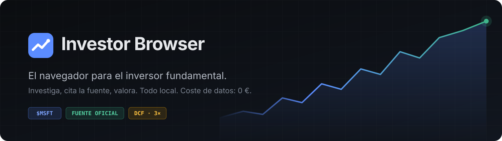

<br>

**Abre el informe anual. Selecciona la cifra. Guárdala con su fuente. Valora la empresa.**<br>
Sin salir del navegador, sin suscripciones y sin que tus datos salgan de tu equipo.

<br>

[](LICENSE)
[](docs/ARCHITECTURE.md)
[](tsconfig.json)
[](#-calidad-y-pruebas)
[](docs/DATA_SOURCES.md)
[](docs/DATA_SOURCES.md)
[](PRIVACY.md)
[](#-instalación)

[**Qué hace**](#-qué-hace) · [**Capturas**](#-en-imágenes) · [**Instalación**](#-instalación) · [**Seguridad**](#-seguridad-primero) · [**Hoja de ruta**](#-hoja-de-ruta) · [**Contribuir**](CONTRIBUTING.md)

</div>

---

## 💡 Por qué existe

Investigar una empresa hoy significa tener **diez pestañas, cinco hojas de cálculo y cuatro herramientas** que no se hablan entre sí. Copias una cifra del 10-K a una hoja, pierdes de dónde salió, y tres meses después ya no sabes si ese «flujo de caja libre» era el publicado o uno que calculaste tú.

**Investor Browser es un navegador real (Chromium) diseñado alrededor del flujo de trabajo del inversor fundamental:**

> Cada cifra sabe de dónde viene. Cada cálculo enseña su fórmula. Cada conclusión queda junto a la empresa.

<table>
<tr>
<td width="33%" valign="top">

### 🔎 Investiga
Navega por webs de inversores, informes en PDF y presentaciones con pestañas agrupadas por empresa.

</td>
<td width="33%" valign="top">

### 📌 Cita la fuente
Selecciona texto o una cifra, clic derecho y queda guardada **con URL, título y fecha de consulta**.

</td>
<td width="33%" valign="top">

### 🧮 Valora
Múltiplos, DCF en tres escenarios y sensibilidad, con tus cifras y **el origen de cada dato a la vista**.

</td>
</tr>
</table>

---

## ✨ Qué hace

### 🗂️ Espacios de investigación por empresa
- Crea empresas con **ticker + bolsa** (las homónimas en distintos mercados son empresas distintas), país, sector, web de relaciones con inversores y CIK de la SEC.
- **Pestañas vinculadas**: llevan el color y el ticker de su empresa en la barra lateral. Los enlaces que abres desde ellas heredan la empresa.
- **Guardar y cerrar espacio** cuando terminas; **Abrir espacio** y todo vuelve donde lo dejaste.

### 📌 Cuaderno con procedencia
- **Clic derecho → «Guardar en investigación…»**, `Ctrl+Shift+S` o el botón del panel lateral. Funciona en webs y en **PDF**.
- Cinco tipos de entrada: **fragmento**, **cifra**, **nota**, **conclusión** y **pregunta** (con «marcar como resuelta»).
- **«Guardar como cifra…»** interpreta números copiados de informes (`$245,122 million`, `1.234,5 M€`, `(12,345)`, `€2,3 mil millones`) y **avisa si el separador es ambiguo**. Nunca guarda sin tu confirmación.

### 🏛️ Datos oficiales de la SEC (gratis, sin clave)
- **Vincula la empresa con su registro en la SEC** por ticker o nombre. Funciona con emisores de EE. UU. y con extranjeros que presentan 20-F o 40-F, en su moneda (US-GAAP e IFRS).
- **Importa diez años de cifras XBRL** de los informes anuales: ingresos, márgenes, beneficio, flujo de caja operativo, CAPEX, caja, deuda, acciones, BPA y dividendo.
- **Cada cifra dice de dónde sale**: documento (10-K, 20-F…), fecha de presentación, concepto XBRL, periodo exacto y enlace a EDGAR.
- **⚠ Re-expresiones a la vista**: si un informe posterior cambió la cifra de un año, lo ves junto al valor original.
- **Presentaciones recientes** (anuales, trimestrales, 8-K, insiders, juntas) a un clic, abiertas en pestañas de la empresa.
- Respeta las normas de la SEC:
  - te identificas con tu contacto, y sin él no hay ninguna petición;
  - máximo 8 consultas por segundo;
  - caché local, que también da una copia fechada si no hay conexión.

### 🔬 Análisis que se explica solo
- **Calidad del negocio**: siete criterios independientes (crecimiento, margen, conversión en caja, ROIC, deuda, dilución y estabilidad).
  - Cada uno muestra **su regla, su fórmula y las cifras exactas** que usa.
  - Nada de puntuaciones mágicas: «6 de 7 criterios fuertes» y los no evaluables aparte.
  - La valoración va **separada**: un gran negocio puede estar caro.
- **Forense contable**: diez señales que dicen **dónde leer con más atención**, por ejemplo:
  - beneficio que sube mientras la caja baja;
  - clientes que crecen más que las ventas;
  - dilución, remuneración en acciones (SBC) elevada o cifras re-expresadas.

  Cada señal explica por qué importa y sus limitaciones. Nunca habla de fraude.
- **Insiders (Form 4)**: compras y ventas de directivos y consejeros leídas de la SEC.
  - Separa lo **discrecional** de las ventas con **plan 10b5-1**, las concesiones y las retenciones fiscales.
  - Porque no toda venta es una señal.
- **Comparar empresas**: hasta cinco lado a lado.
  - Avisa si los ejercicios, los cierres fiscales o las monedas no coinciden.
  - Marca como «Pendiente» lo que no tiene fuente.

### 📊 Dossier de empresa
- **Cifras clave por periodo** en una sola unidad («millones de USD»), con un punto que indica su origen:
  `🟢 publicado` · `🔵 cálculo propio` · `⚪ introducido por ti` · `🟠 estimación`.
- **FCL** (FCO − CAPEX) y **deuda neta** derivados automáticamente, **con la fórmula y las cifras de origen** al pasar el ratón.
- Márgenes bruto, operativo, neto y de FCL, y **conversión en caja** (FCO / beneficio neto).
- **Los huecos se quedan en «—», nunca en cero.** Un dato publicado siempre gana a un cálculo propio.
- **Combina tus cifras con las oficiales de la SEC**: tus anotaciones del mismo periodo tienen prioridad.
- **Precio manual** con fecha y fuente. Si no lo introduces: *«Cotización no disponible»*. Sin datos retrasados disfrazados de tiempo real.
- **Tesis de inversión** con autoguardado, **preguntas pendientes**, **fuentes consultadas** y enlaces directos a **10-K, 10-Q, 8-K, Form 4 y 20-F** en SEC EDGAR.

### 🧮 Laboratorio de valoración
- **PER, EV/EBIT, EV/EBITDA, P/FCL, rentabilidad FCL y por dividendo**, cada uno con su fórmula.
- Cuando un múltiplo no tiene sentido (beneficio negativo, faltan datos) **te dice por qué** en lugar de mostrar un número absurdo.
- **Ajustes sectoriales**: bancos, aseguradoras y REIT/SOCIMI ocultan métricas que no aplican y explican cuáles usar.
- **DCF en tres escenarios** (pesimista, base y optimista) editables, **peso del valor terminal** con aviso si supera el 75 % y **tabla de sensibilidad** coloreada frente al precio.
- **«Cargar cifras guardadas»** rellena los datos desde el dossier indicando el origen de cada uno, y puedes guardar el resultado como conclusión.

### 🛡️ Señales de confianza
- Distintivo **«Fuente oficial»** en la barra de direcciones para SEC, CNMV, ESMA, BCE, Banco de España, FRED, Eurostat, INE, BaFin, AMF… Exige **HTTPS y dominio exacto**: `sec.gov.evil.com` no lo consigue.
- Chip **«IR · MSFT»** cuando estás en la web de inversores de una de tus empresas, con propuesta de vincular la pestaña.
- Escribe **`$MSFT`** en la barra de direcciones y vas directo al dossier.

### 🌐 Un navegador completo
Pestañas verticales (estilo Arc) u horizontales, fijadas, reordenables y reabribles · restauración de sesión con carga diferida · favoritos con importación/exportación desde Chrome, Edge y Firefox · historial por días · descargas con pausa y reanudación · buscar en la página · zoom · visor de PDF integrado · permisos por sitio · **paleta de comandos `Ctrl+K`** · modo foco.

### 🎨 Tres temas pensados para leer durante horas
**Grafito** (oscuro, por defecto) · **Terminal** (negro y ámbar, denso, para sesiones largas) · **Claro**, o el del sistema.

---

## 📸 En imágenes

> Capturas reales de la aplicación. La empresa y las cifras son **ficticias**, creadas solo para la demostración.

<table>
<tr>
<td width="50%">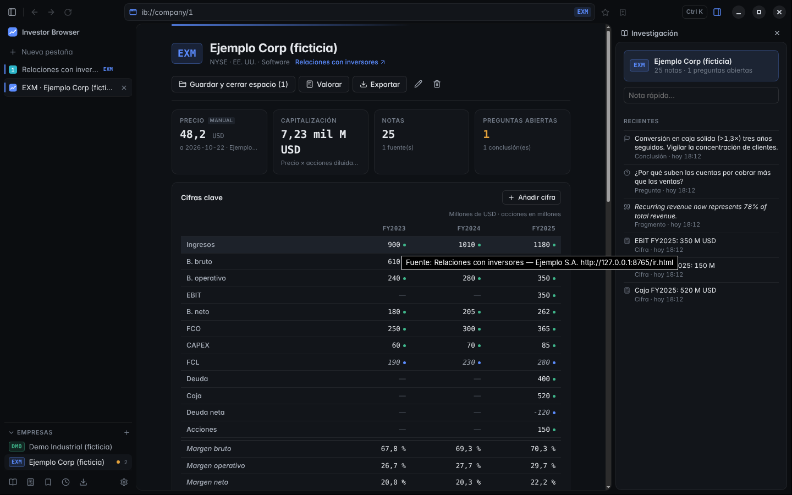<br><sub><b>Dossier</b> · cifras por periodo con origen, panel de investigación y fuentes primarias</sub></td>
<td width="50%">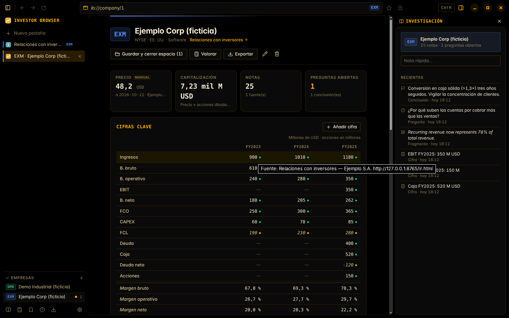<br><sub><b>Tema Terminal</b> · negro y ámbar, alta densidad</sub></td>
</tr>
<tr>
<td width="50%">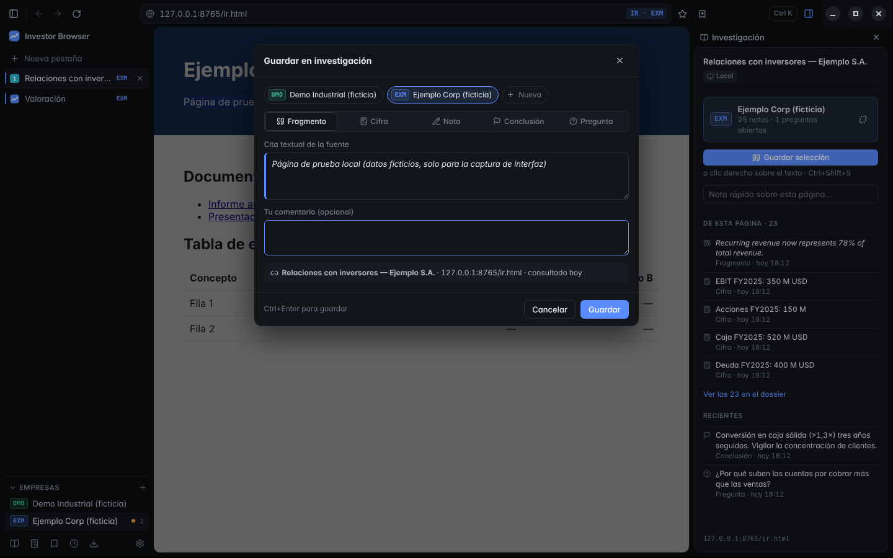<br><sub><b>Guardar en investigación</b> · la cita conserva URL, título y fecha</sub></td>
<td width="50%">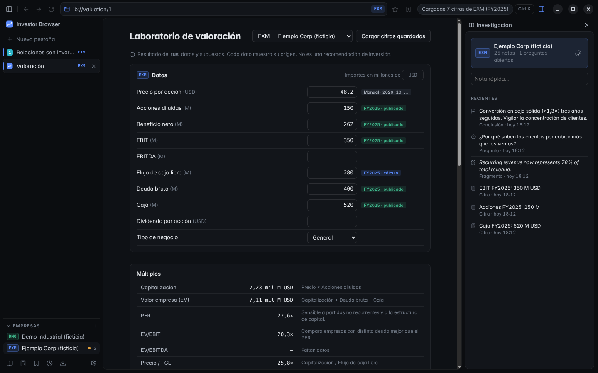<br><sub><b>Valoración</b> · cada dato muestra de dónde viene</sub></td>
</tr>
<tr>
<td colspan="2">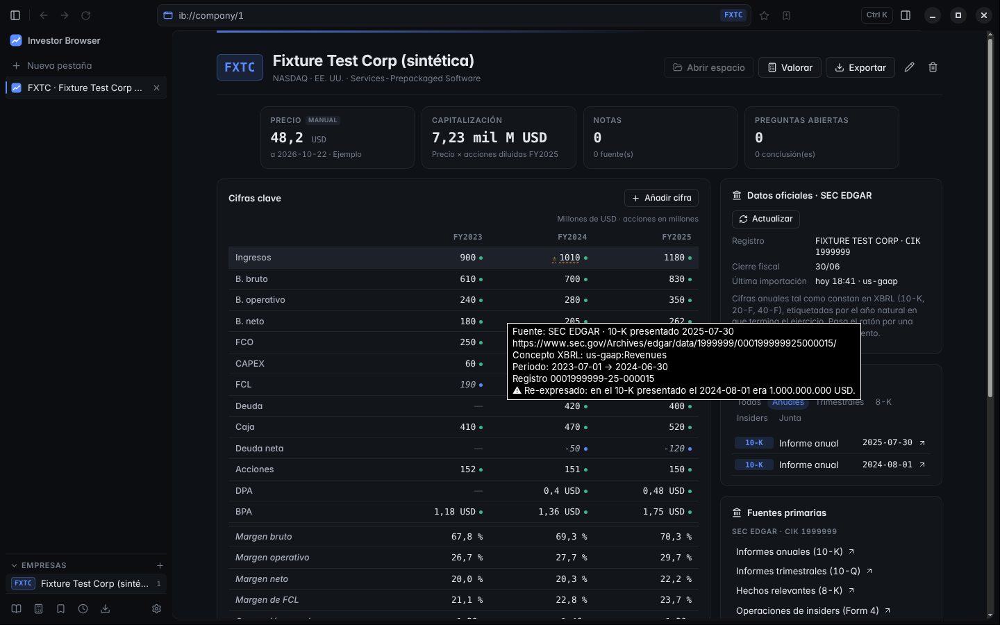<br><sub><b>SEC EDGAR</b> · cifras XBRL con documento, concepto y periodo; ⚠ marca una cifra re-expresada en un informe posterior (empresa sintética de prueba)</sub></td>
</tr>
<tr>
<td width="50%">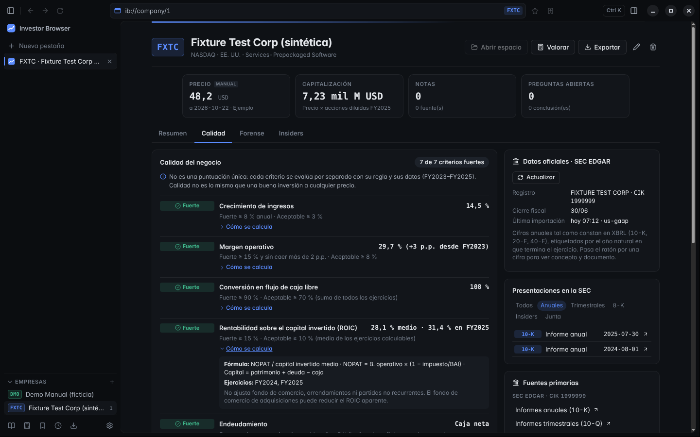<br><sub><b>Calidad</b> · cada criterio con su regla, fórmula y datos</sub></td>
<td width="50%">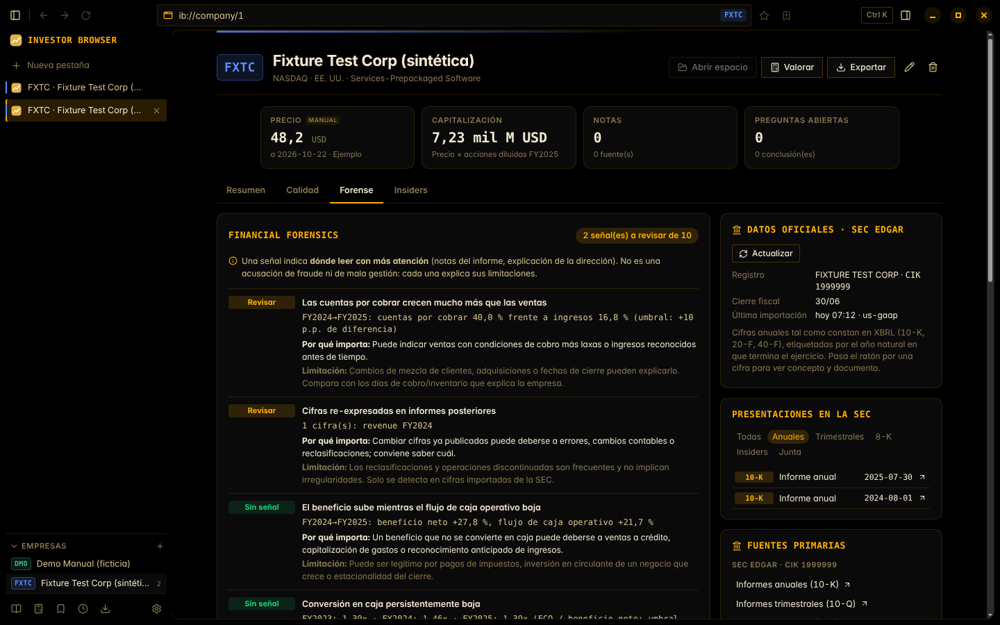<br><sub><b>Forense</b> · señales con motivo y limitación (tema Terminal)</sub></td>
</tr>
<tr>
<td width="50%">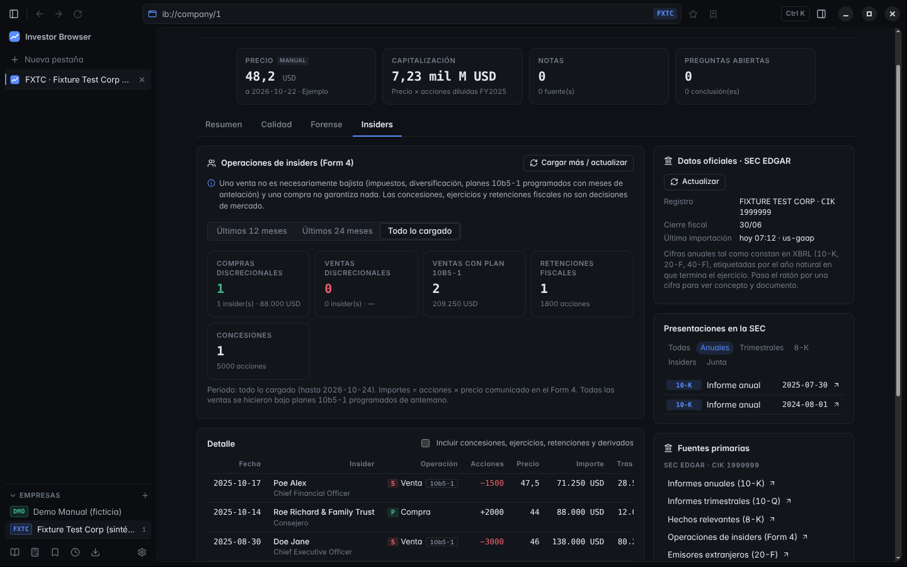<br><sub><b>Insiders</b> · discrecional frente a planes 10b5-1</sub></td>
<td width="50%">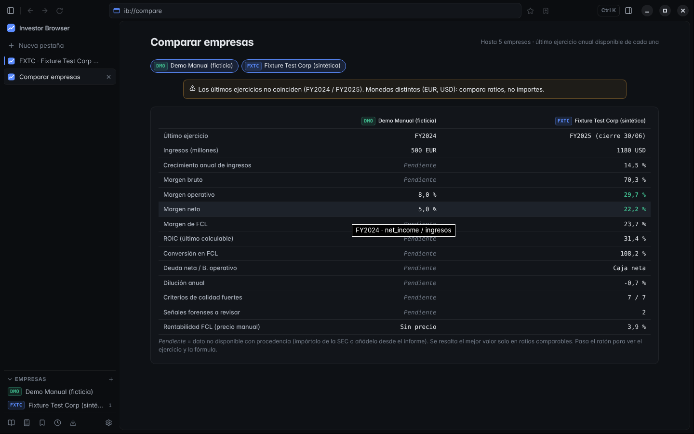<br><sub><b>Comparar</b> · con avisos de periodos y monedas distintos</sub></td>
</tr>
<tr>
<td width="50%">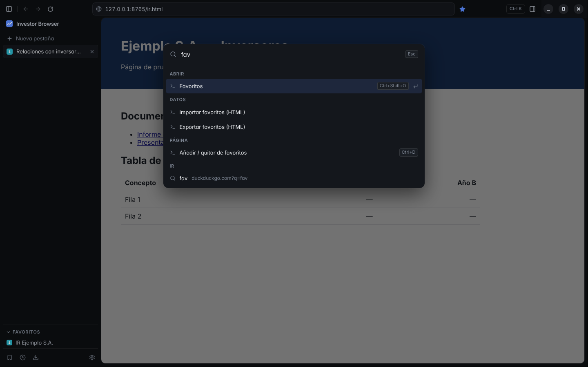<br><sub><b>Paleta de comandos</b> · <code>Ctrl+K</code> para todo</sub></td>
<td width="50%">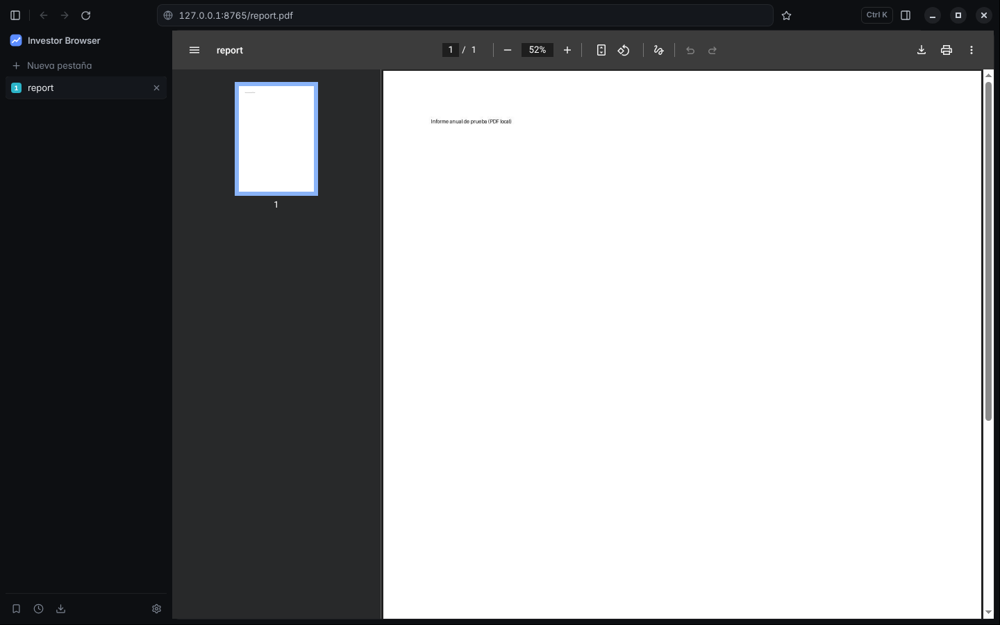<br><sub><b>Informes en PDF</b> · abiertos dentro de la pestaña, listos para citar</sub></td>
</tr>
</table>

---

## 🔁 Un flujo de trabajo típico

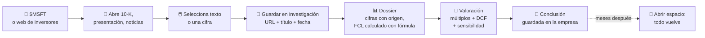

---

## 🧭 Principios innegociables

| | Principio | Cómo se cumple |
|---|---|---|
| 💶 | **Coste de datos: 0 €** | Ninguna función obligatoria usa APIs de pago. Fuentes previstas: SEC EDGAR, FRED, Treasury, Eurostat ([evaluación](docs/DATA_SOURCES.md)). |
| 🧾 | **Ninguna cifra inventada** | Huecos en «—», nunca 0. Cada valor muestra si es publicado, calculado, tuyo o estimado. |
| 🕒 | **Nada retrasado se presenta como actual** | El precio es manual con fecha y fuente; sin él, «Cotización no disponible». |
| 🔒 | **Tus datos son tuyos** | Todo en SQLite local. Sin telemetría, sin cuentas, sin sincronización. |
| 🧑‍⚖️ | **Ayuda a pensar, no decide por ti** | Las fórmulas están a la vista; ninguna puntuación opaca. No es asesoramiento financiero. |

---

## 🛡️ Seguridad primero

Las páginas web se tratan como **hostiles por defecto**. Ninguna puede tocar Node, el disco, la base de datos ni el puente interno de la aplicación.

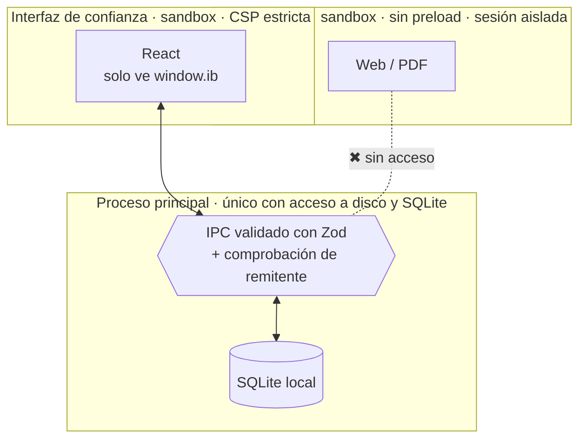

- **Sandbox de Chromium en todos los procesos**, `contextIsolation` activo, `nodeIntegration` desactivado y **cero preload en las pestañas**.
- **IPC con esquemas Zod** y verificación de remitente en cada canal. Las cargas inválidas se rechazan (cubierto por tests).
- Solo `http(s)` en pestañas. **`javascript:`, `file:`, `data:`… bloqueados**; `mailto:` y `tel:` solo con tu confirmación.
- La selección para guardar se lee en un **mundo JavaScript aislado**: la página no puede falsearla ni recibe código.
- Citas y notas se muestran **siempre como texto**. Un test E2E intenta colar `<script>` e ``.
- **Certificados inválidos bloqueados sin opción de «continuar de todos modos»**, permisos por sitio denegados por defecto, `<webview>` prohibido y descargas que nunca sobrescriben.
- Los registros no guardan URLs con parámetros, cookies ni formularios.

📖 Detalle completo: [Modelo de seguridad](docs/SECURITY_MODEL.md) · Informar de una vulnerabilidad: [SECURITY.md](SECURITY.md)

---

## 🚀 Instalación

### Desde el código (Windows, macOS o Linux)

```bash
git clone https://github.com/InversorIbex/INVESTOR_BROWSER.git
cd INVESTOR_BROWSER
npm install
npm run dev        # modo desarrollo con recarga
```

Requisitos: **Node.js ≥ 22.12** y npm 10. No hace falta ninguna clave de API.

### Instalador para Windows 10/11 (x64)

```bash
npm run dist:win   # → release/Investor-Browser-Setup-<versión>-x64.exe
```

También lo genera automáticamente [GitHub Actions](.github/workflows/ci.yml) en `windows-latest` como artefacto descargable, con su SHA-256.

> [!WARNING]
> El instalador **todavía no está firmado digitalmente**: Windows SmartScreen mostrará un aviso. La firma de código y las actualizaciones automáticas firmadas están previstas antes de la v1.0. Al desinstalar, **tu investigación se conserva** en `%APPDATA%\Investor Browser`.

### Otros comandos

| Comando | Qué hace |
|---|---|
| `npm start` | Compila y arranca la versión de producción |
| `npm run dist:linux` | Genera un AppImage |
| `npm run typecheck` | TypeScript estricto |
| `npm test` | Pruebas unitarias |
| `npm run test:e2e` | Pruebas E2E con Electron real |

---

## ⌨️ Atajos esenciales

| Atajo | Acción | | Atajo | Acción |
|---|---|---|---|---|
| `Ctrl+K` | Paleta de comandos | | `Ctrl+Shift+S` | Guardar selección en investigación |
| `Ctrl+L` | Barra de direcciones | | `Ctrl+Shift+E` | Empresas e investigación |
| `Ctrl+T` / `Ctrl+W` | Nueva / cerrar pestaña | | `Ctrl+.` | Panel de investigación |
| `Ctrl+Shift+T` | Reabrir pestaña cerrada | | `Ctrl+F` | Buscar en la página |
| `Ctrl+1…9` | Ir a la pestaña | | `F11` / `Ctrl+\` | Modo foco |
| `Ctrl+D` | Añadir a favoritos | | `$TICKER` + `Enter` | Abrir el dossier |

Todos los atajos aparecen en **Ajustes › Atajos de teclado** y en la paleta.

---

## 🧱 Arquitectura

| Capa | Tecnología | Por qué |
|---|---|---|
| Escritorio | **Electron 44** (Chromium 152, Node 24) | Navegación real, una `WebContentsView` aislada por pestaña |
| Interfaz | **React 19 + TypeScript** estricto | Componentes simples, sin framework de estado |
| Datos | **SQLite integrado** (`node:sqlite`) | Sin módulos nativos que recompilar; migraciones versionadas |
| Validación | **Zod** | Un único contrato compartido entre UI y proceso principal |
| Build | **Vite + esbuild** | Rápido y sin capas extra |
| Pruebas | **Vitest + Playwright** | Lógica pura en unitarias; navegador real en E2E |

```
src/
├── shared/    lógica pura y testeable: URLs, finanzas, valoración, fuentes, IPC
├── main/      proceso principal: pestañas, seguridad, SQLite, investigación
├── preload/   puente mínimo para la UI (window.ib)
└── renderer/  interfaz React: componentes, páginas ib://, estilos
```

📖 [Arquitectura](docs/ARCHITECTURE.md) · [Modelo de datos](docs/DATA_MODEL.md) · [Fuentes de datos](docs/DATA_SOURCES.md)

---

## ✅ Calidad y pruebas

- **121 pruebas unitarias**, entre ellas:
  - interpretación de cifras en formatos de EE. UU. y Europa;
  - DCF contrastado con un cálculo a mano;
  - rechazo de dominios impostores;
  - exportar e importar ida y vuelta;
  - regresiones de ajustes y empresas;
  - normalización XBRL con las trampas reales de la SEC (`fy` del documento, re-expresiones, trimestres, IFRS en DKK);
  - cliente SEC: sin petición sin contacto, ritmo, caché, errores;
  - análisis contrastado a mano (CAGR, ROIC con capital medio, ratio de Sloan) en casos fuertes, débiles y sin datos;
  - Form 4 con la estructura de un formulario real, plan 10b5-1 por casilla y por nota, y XML hostil (XXE, «billion laughs»).
- **8 pruebas E2E con Electron real** contra servidores locales, sin depender de Internet:
  - navegación, pestañas, atrás/adelante, búsqueda y errores;
  - persistencia tras reiniciar y descargas;
  - paleta de comandos;
  - flujo de investigación completo;
  - contenido hostil que debe mostrarse como texto;
  - SEC simulada: consentimiento, User-Agent, ritmo medido en el servidor, cifras con procedencia y modo sin conexión;
  - calidad, forense, insiders desde el archivo EDGAR simulado y comparación de empresas.
- **CI en Linux y Windows**: typecheck, pruebas, E2E y generación del instalador.

---

## 🗺️ Hoja de ruta

- [x] **Fase 1** · Navegador funcional, seguro y persistente
- [x] **Fase 2** · Espacios de investigación, cuaderno con procedencia, dossier, exportación
- [x] **Fase 4 (parcial)** · Laboratorio de valoración: múltiplos, DCF, sensibilidad
- [x] **Fase 3** · Cifras oficiales desde **SEC EDGAR** (XBRL): procedencia por cifra, re-expresiones, presentaciones, caché y acceso justo
- [x] **Fase 4** · Quality Compounder · Financial Forensics · Insider Tracker (Form 4) · Comparar empresas
- [ ] **Crash Replay** · pendiente de una fuente de cotizaciones históricas con licencia gratuita
- [ ] **Fase 5** · Investment Copilot **opcional**: sin IA por defecto, con consentimiento antes de enviar nada
- [ ] **Fase 6** · Firma de código, actualizaciones firmadas, pruebas en Windows 10 y 11 reales

Criterios de aceptación y riesgos: [docs/ROADMAP.md](docs/ROADMAP.md) · Cambios: [CHANGELOG.md](CHANGELOG.md)

---

## ❓ Preguntas frecuentes

<details>
<summary><b>¿De dónde salen las cifras automáticas?</b></summary>

De la API oficial y gratuita de la SEC (XBRL de los informes 10-K, 20-F y 40-F). Solo se consulta cuando tú lo pides y cada cifra enlaza al documento original. Para empresas que no presentan ante la SEC (p. ej. muchas europeas sin ADR), usa el cuaderno: selecciona la cifra en su informe anual y guárdala con su fuente.
</details>

<details>
<summary><b>¿Muestra cotizaciones en tiempo real?</b></summary>

No. No existe una fuente gratuita, fiable y con condiciones que lo permitan. El precio se introduce a mano con su fecha y fuente, y se usa así en los cálculos. Nunca se presenta un dato retrasado como actual.
</details>

<details>
<summary><b>¿Mis notas se suben a algún sitio?</b></summary>

No. Todo vive en una base de datos SQLite en tu equipo. Puedes exportarlo a Markdown o JSON y crear copias de seguridad completas desde Ajustes.
</details>

<details>
<summary><b>¿Sirve para empresas europeas o españolas?</b></summary>

Sí. El cuaderno, el dossier y la valoración funcionan con cualquier empresa y moneda, y entienden formatos como `1.234,5 M€`. Los enlaces a EDGAR solo aplican a emisores registrados en la SEC. La CNMV, ESMA y los reguladores europeos aparecen como fuente oficial.
</details>

<details>
<summary><b>¿Puedo cambiar el nombre y la marca?</b></summary>

Sí: edita `src/shared/brand.ts`, `productName` en `package.json` y regenera los iconos con `python3 scripts/make-icons.py "#COLOR"`.
</details>

---

## 🤝 Contribuir

¡Bienvenidas las contribuciones! Antes de nada, lee [CONTRIBUTING.md](CONTRIBUTING.md). Hay cuatro reglas de oro:

1. **Seguridad antes que funciones.**
2. **Datos honestos.**
3. **Coste cero.**
4. **Pequeño y mantenible.**

Para proponer una nueva fuente de datos usa la [plantilla específica](.github/ISSUE_TEMPLATE/data_source.md), con su licencia y sus límites.

---

<details>
<summary><b>🇬🇧 English summary</b></summary>

**Investor Browser** is an open-source, security-first desktop browser (Electron/Chromium) built for fundamental stock investors:

- **Research workspaces per company:** tabs are grouped by ticker and can be saved and restored.
- **Provenance-aware notebook:** right-click any selection on a web page or PDF to save it with its URL, title and access date. Figures copied from reports are parsed with ambiguity warnings.
- **Company dossier:** shows each figure's origin (published / own calculation / user / estimate) and derives FCF and net debt with visible formulas. Gaps are never filled with zeros.
- **Analysis that explains itself:**
  - quality criteria with rules, formulas and inputs, kept separate from valuation;
  - ten forensic signals with their limitations;
  - a Form 4 insider tracker that separates discretionary trades from 10b5-1 plans;
  - side-by-side company comparison.
- **Official SEC EDGAR data:** ten years of XBRL annual figures (US-GAAP and IFRS) with document, concept and period for every number, restatement flags, and the filings list. It follows the SEC's fair-access rules: declared contact, at most 8 requests per second, local cache.
- **Valuation lab:** multiples with reasons when they don't apply, sector adjustments, a 3-scenario DCF and a sensitivity grid.
- **Trust signals:** official-source badges for regulator domains (HTTPS and exact host only) and an IR badge on a company's investor-relations site.

It has zero data cost and no telemetry, and all data stays on your machine. Docs are in Spanish; code and comments are in English. Licensed under Apache-2.0.
</details>

<div align="center">

<br>

**Licencia [Apache-2.0](LICENSE)** · Hecho para inversores que leen las cuentas.

<sub>Investor Browser es una herramienta de investigación. No es asesoramiento financiero y no ejecuta operaciones bursátiles.</sub>

</div>
